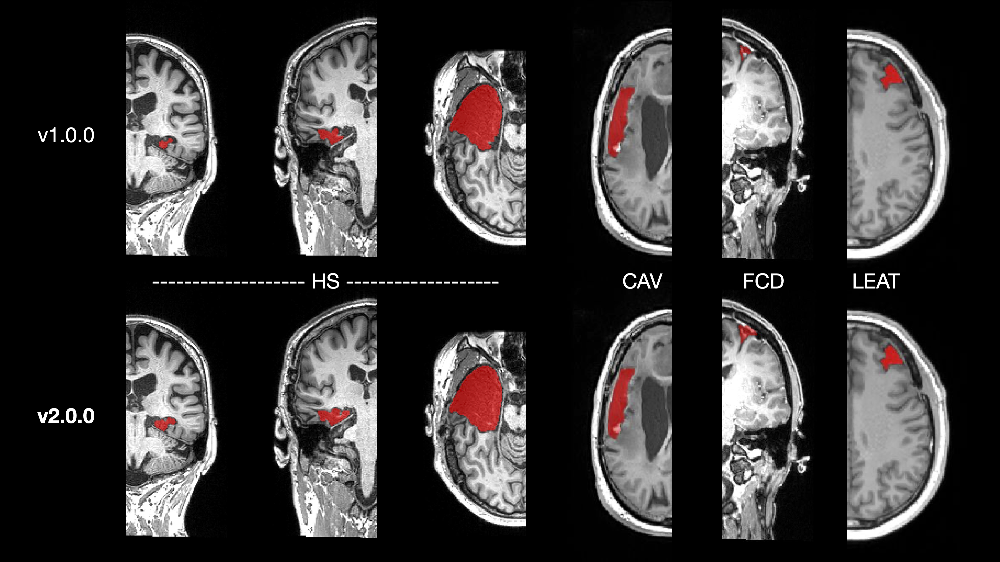

# MELD-PostOp
**Publication**: [here](https://onlinelibrary.wiley.com/doi/epdf/10.1002/epi.70450)

MELD-PostOp is an automated tool for segmenting resection cavities on postoperative T1w MRI scans of epilepsy patients, developed using the nnU-Net framework.
This page provides instructions for installing the pretrained MELD-PostOp model and running inference on new patients.

## UPDATE
### What's new in MELD-PostOp v2.0.0?
V2 improves segmentation in **selective amygdalohippocampectomy** cases. In particular, cases where v1 missed hippocampal resections are better segmented by v2.



**For more detail**: [MELD-PostOp version comparison](https://github.com/MELDProject/MELD-PostOp/blob/v2_draft/docs/version_comparison.md)

## LICENSE
We kindly ask all MELD-PostOp users to complete the MELD-PostOp registration form. After submission, you will receive a license file, which is required to use MELD-PostOp v1 and v2.
If you have already registered and have a license file for v1, copy it to MELD-PostOp_v2/model/ 

[**MELD-PostOp Registration Form**](https://forms.gle/Sm8ZDUbU8GThfqwb6)

Your email address will also be added to the MELD-PostOp mailing list so we can keep you informed about bug fixes and new releases.

### System requirements
- The instructions below were tested on Linux (Ubuntu 22.04.5)
- Python: 3.9 or newer (`environment.yml` pins 3.13.5)
- Hardware: GPU is strongly recommended


## 1. MELD-PostOp v2 installation & setup
### 1.1 Clone the repository
```bash
git clone https://github.com/MELDProject/MELD-PostOp.git
cd MELD-PostOp
```

### 1.2 Create the virtual environment
We recommend using **Anaconda** to manage the Python environment and dependencies.
Please follow the official installation instructions for [Anaconda](https://docs.conda.io/projects/conda/en/latest/user-guide/install/index.html).

```bash
conda env create -f environment.yml
conda activate meldpostop
```
This creates an environment named `meldpostop` with Python 3.13.5 and installs [nnU-Net v2](https://github.com/MIC-DKFZ/nnUNet) (`pip install nnunetv2`), the framework MELD-PostOp is built on.

### 1.3 Download the pretrained model
Download the pretrained MELD-PostOp model archive (_MELD-PostOp_v2.zip_) from Figshare and unzip it locally. The unzipped folder (`MELD-PostOp_v2/`) is your **data folder**; it can be anywhere on your system, separate from the cloned repository.
- [MELD-PostOp Figshare](https://doi.org/10.6084/m9.figshare.35003707)
- version: v2.0.0

### 1.4 License setup
A valid **MELD-PostOp license file** is required to run inference. After completing the MELD-PostOp registration form, you will receive a license file.
Place the license file in `MELD-PostOp_v2/model/`. Inference will fail if no valid license file is found.

### 1.5 Configure the data folder path
Open `meldpostop_config.ini` in the cloned repository and set the path to your `MELD-PostOp_v2` folder:

```ini
[paths]
meldpostop_weight_path = /path/to/MELD-PostOp_v2/
```
_If you wish to use model v1, set meldpostop_weight_path to the folder containing the [v1 model weights](https://figshare.com/s/c5a3d4a5604b229eeb5f)._


### 1.6 Directory structure
After completing the installation and setup, your data folder should have the following structure:
```
MELD-PostOp_v2/
├── input_<key>/                                      < your input data (see section 2)
├── model/
│   ├── (MELD-PostOp license file, .txt)
│   └── Dataset001_MELDPostOp_v2.0.0/
│       └── nnUNetTrainer__nnUNetPlans__3d_fullres/   < (pretrained model weights)
```

### 1.7 Make the command executable
```bash
chmod +x run_meldpostop.sh
```

## 2. Data preparation
### 2.1 Input data requirements
- Input images must be postoperative **T1-weighted MRI scans**
- Images must be in **NIfTI format** (`.nii` or `.nii.gz`)
- **NOTE:** MELD-PostOp was trained on postoperative T1w MRI scans from patients who had lesionectomy or lobectomy. It may not be appropriate for other procedures (e.g. laser ablation, thermocoagulation etc.).

### 2.2 File naming
- All input files must follow nnU-Net naming conventions
- Each file name must include:
     - a subject id
     - the modality suffix `_0000`, indicating T1w
- Example: `sub-<subject_id>_0000.nii.gz`

### 2.3 Input directory
- To process a dataset, create an input directory named `input_<key>` inside your `MELD-PostOp_v2/` folder, where `<key>` is an input dataset identifier
- The key can be any string (e.g. `003`, `siteA`, `cohort_2026.v1`)
- **Each key must be unique.** The script refuses to run if `output_<key>` already exists and is not empty, so previous results are not overwritten by accident
- Place all NIfTI files for a given dataset directly inside the corresponding input directory
- Output directories are generated automatically:
     - `input_siteA` → `output_siteA`
     - `input_003` → `output_003`
     - No manual creation of output directories is required

Example:
```
MELD-PostOp_v2/
├── input_siteA/
│   ├── sub-001_0000.nii.gz
│   └── sub-002_0000.nii.gz
└── output_siteA/          < created automatically
```

## 3. Running MELD-PostOp inference
### 3.1 Inference
Activate the environment and run, from the cloned repository:
```bash
bash run_meldpostop.sh -k <key>
```
**Flags**
| Option | Description |
|--------|-------------|
| `-k <key>` | **Required.** Unique dataset key. Uses `input_<key>` and creates `output_<key>` |
| `-c <file>` | Use a different config file (default: `meldpostop_config.ini` next to the script) |
| `-f` | Overwrite an existing, non-empty `output_<key>` |
| `-h` | Show usage |

### 3.2 What happens when you run it
Before inference starts, the script:
1. Checks that the `meldpostop` environment (nnU-Net) is active
2. Validates the license file in `model/` and prints its path and ID
3. Detects the model version from the model folder (e.g. `MELD-PostOp_v2.0.0`)
4. Counts the input files in `input_<key>`

It then prints a summary and starts inference:
```
================================================================================
 MELD-PostOp
================================================================================
 Key:            siteA
 Model version:  MELD-PostOp_v2.0.0 (model weight: Dataset001_MELDPostOp_v2.0.0)
 License file:   /path/to/MELD-PostOp_v2/model/meld_postop_license.txt
 License ID:     123456
 Input files:    2 subject(s) (2 nifti files)
 Input dir:      /path/to/MELD-PostOp_v2/input_siteA
 Output dir:     /path/to/MELD-PostOp_v2/output_siteA
================================================================================
```

### 3.3 Outputs
`output_<key>/` contains the predicted segmentations (and probability maps, if `save_probabilities = true`), plus a `metadata.json` file recording the model version, dataset key, license ID, number of input files, input/output paths and timestamp.


## Additional information
After running inference with MELD-PostOp, you may wish to perform **external validation** of the model on your dataset.
Please refer to the following link for detailed instructions:
- [notebooks](notebooks/)

## Citation
Please cite the following paper when using MELD-PostOp:

Seo J, Ripart M, Kaas H, Kronlage C, Sinclair B, Vivash L, et al. Automated segmentation of postsurgical resection cavities on magnetic resonance imaging in focal epilepsy: A Multicentre Epilepsy Lesion Detection study. *Epilepsia*. 2026; 00: 1–18. https://doi.org/10.1002/epi.70450
